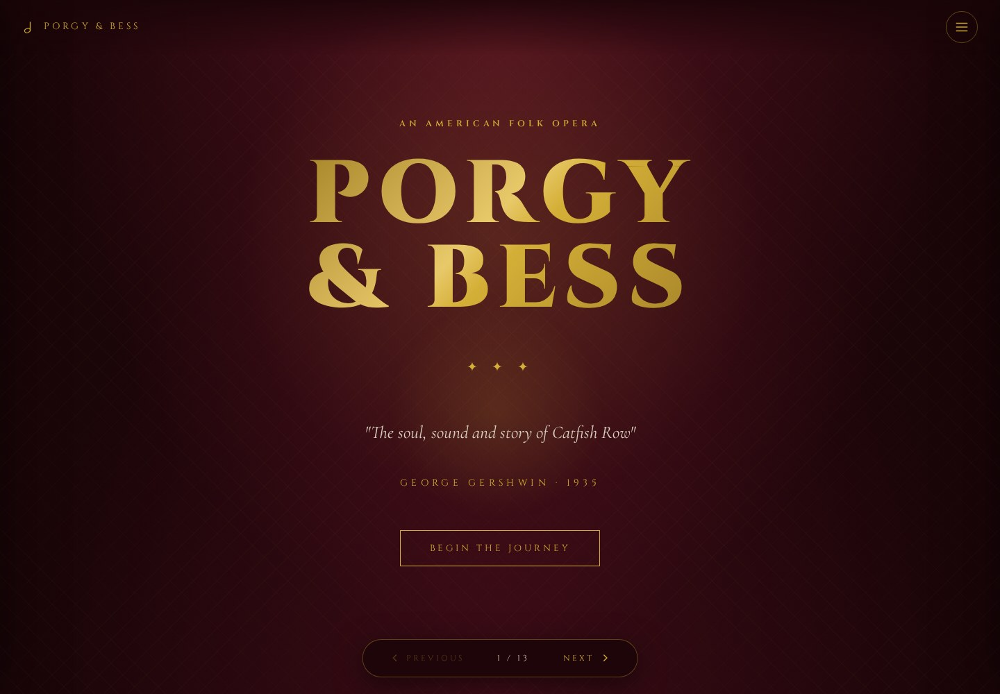
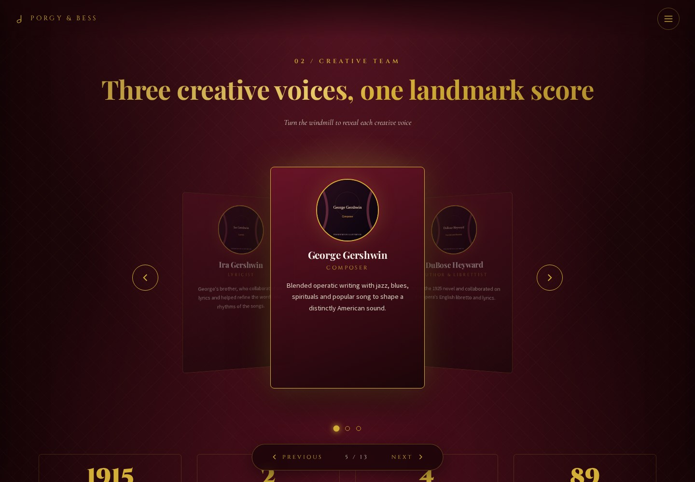
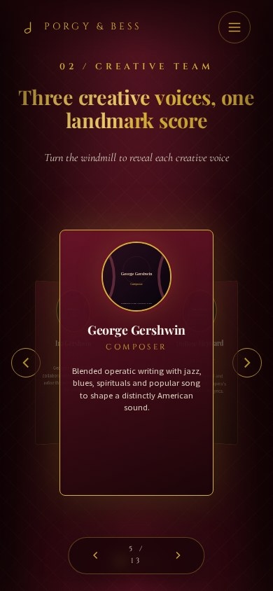

# Porgy and Bess — Interactive Web Presentation

**Educational presentation · HTML · CSS · JavaScript**

A theatre-inspired presentation with 13 scenes, curtain transitions, keyboard navigation, a rotating creative-team display and interactive visual material.

[Hosted presentation](https://porgyandbess.netlify.app/)

## Visual preview

Actual Chromium browser captures of the running site. The opening screen and creative-team scene are shown. 

Creative-team scene preview

Mobile browser preview

Desktop: 1440 × 1000 · Mobile: 390 × 844. [Capture source and provenance](docs/screenshots/capture.json).

## Run locally

~~~bash
python -m http.server 8000
~~~

Open http://localhost:8000. Use the on-screen menu or arrow keys to move between scenes.

## Implemented interactions

- Opening sequence and enter/skip controls.
- Scene navigation with changing stage lighting.
- Creative-team carousel, character flip cards and content tabs.
- An SVG relationship visualisation with animated pulses.
- Synthesised musical notes through the Web Audio API.
- Expandable song notes and optional short recording playback.

## Media status

The repository includes SVG title cards and character nameplates. They are explicitly illustrative graphics, not archival photographs or portraits.

**Song recordings are not bundled.** The cards currently open song information without requesting missing MP3 files. The separate score demonstration generates synthesised notes in the browser.

To connect recordings, add appropriately permitted files at the paths already specified in the song cards and change each card's data-audio-available attribute to true. The current optional playback limit is five seconds.

## Files

| Path | Purpose |
| --- | --- |
| index.html | Presentation scenes and source list |
| style.css | Stage design, layout and animations |
| script.js | Navigation, visual interactions and browser audio |
| assets/illustrations/ | Bundled illustrative SVG graphics |
| .github/ | Browser checks |

Google Fonts are optional external resources. The technical demo can use the browser's fallback fonts.

